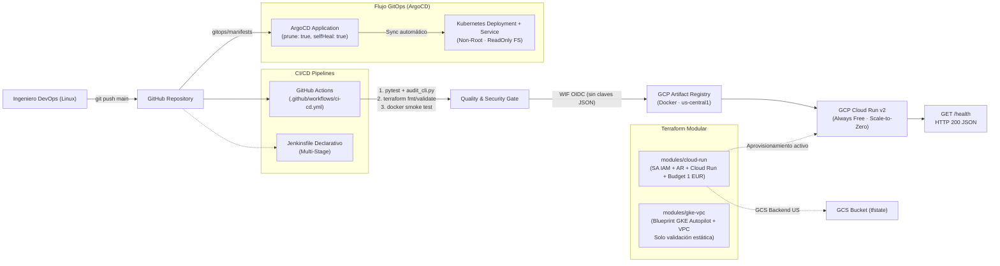

# GCP DevOps & GitOps Demo (Always Free · 0 EUR)

[](https://github.com/JagaScripts/gcp-devops-gitops-demo/actions/workflows/ci-cd.yml)


Demostración técnica *end-to-end* de ingeniería DevOps, Infraestructura como Código (IaC), CI/CD y GitOps sobre **Google Cloud Platform (Always Free)**, diseñada bajo principios de **coste 0 EUR**, **mínimo privilegio (IAM)**, contenedores **no-root** y **cero secretos en Git**.

> **Demo viva en Cloud Run (`/health`):** _Pendiente de despliegue inicial tras `git push` y configuración de secretos GCP en GitHub Actions._  
> Endpoint esperado tras despliegue: `https://<cloud-run-service-url>/health` → HTTP `200` JSON `{"status": "ok", ...}`.

---

## Arquitectura Completa



---

## Estructura del Repositorio

```text
.
├── app/                         # Microservicio HTTP ligero en Python (stdlib, /health JSON)
├── scripts/                     # CLI de auditoría con logging estructurado JSON
├── tests/                       # Suite unitaria pytest (microservicio + auditoría CLI)
├── terraform/
│   ├── main.tf                  # Stack raíz Always Free (Cloud Run + alerta presupuesto 1 EUR)
│   ├── backend.tf               # Backend GCS parametrizado (sin hardcodear bucket)
│   ├── terraform.tfvars.example # Ejemplo de variables sin secretos
│   └── modules/
│       ├── cloud-run/           # Módulo activo: SA mínimo privilegio, Artifact Registry, Cloud Run v2
│       └── gke-vpc/             # Blueprint GKE Autopilot + VPC (solo validación estática)
├── .github/workflows/ci-cd.yml  # Pipeline CI/CD en GitHub Actions (WIF + Cloud Run)
├── Jenkinsfile                  # Pipeline declarativo multi-stage sin credenciales hardcodeadas
├── gitops/
│   ├── manifests/               # Deployment (hardened no-root) y Service Kubernetes
│   └── argocd/                  # Recurso Application de ArgoCD (automated prune + selfHeal)
├── Dockerfile                   # Build multi-stage con usuario no-root (UID 10001)
└── docs/                        # Plan de sprint, reporte autónomo y evidencias
```

---

## Guardrails de Coste 0 EUR y Seguridad

| Control | Implementación |
| :--- | :--- |
| **GCP Always Free** | Cloud Run en `us-central1` con `min_instance_count = 0`, `cpu_idle = true`, `256Mi` RAM y política de retención en Artifact Registry (máx. 3 versiones). |
| **GKE Autopilot & VPC** | Módulo `terraform/modules/gke-vpc` mantenido fuera del stack raíz para validación estática (`fmt`/`validate`) sin generar costes en la nube. |
| **Alerta de presupuesto** | Recurso opcional `google_billing_budget` limitado a `1 EUR` (umbrales 50 %, 80 %, 100 %). |
| **IAM mínimo privilegio** | Service Account dedicado para Cloud Run únicamente con `roles/logging.logWriter` y `roles/artifactregistry.reader` acotado al repositorio. |
| **Contenedor seguro** | `Dockerfile` multi-stage sobre `python:3.12-slim`, ejecución como usuario `appuser` (`UID 10001`), sin privilegios de `root` y con `HEALTHCHECK`. |
| **Cero secretos en Git** | `.gitignore` bloquea `.tfstate`, `.tfvars`, `.env` y credenciales; autenticación CI/CD diseñada mediante Workload Identity Federation (OIDC). |

---

## Verificación Local (Linux)

### 1. Validación estática de Terraform (todos los módulos)

```bash
terraform fmt -check -recursive terraform
terraform -chdir=terraform init -backend=false -input=false && terraform -chdir=terraform validate
terraform -chdir=terraform/modules/cloud-run init -backend=false -input=false && terraform -chdir=terraform/modules/cloud-run validate
terraform -chdir=terraform/modules/gke-vpc init -backend=false -input=false && terraform -chdir=terraform/modules/gke-vpc validate
```

### 2. Tests unitarios y CLI de auditoría (Python)

```bash
python3 -m venv .venv
.venv/bin/pip install -r requirements-dev.txt
.venv/bin/pytest -v
.venv/bin/python scripts/audit_cli.py \
  --terraform-dir terraform \
  --yaml-dir gitops \
  --yaml-dir .github/workflows
```

### 3. Build y smoke test del contenedor Docker (no-root)

```bash
docker build -t gcp-devops-demo:local .
docker run -d --rm -p 127.0.0.1:8080:8080 --name gcp-devops-demo gcp-devops-demo:local
docker exec gcp-devops-demo id -u
curl -fsS http://127.0.0.1:8080/health
.venv/bin/python scripts/audit_cli.py --health-url http://127.0.0.1:8080/health
docker rm -f gcp-devops-demo
```

---

## Validación GitOps con ArgoCD (Clúster Local Efímero)

Los manifiestos en [`gitops/manifests/`](gitops/manifests/) y la definición [`gitops/argocd/application.yaml`](gitops/argocd/application.yaml) están configurados con sincronización automática (`prune: true`, `selfHeal: true`).

Tras publicar los cambios en `main`, se pueden validar en un clúster local efímero (`kind` o `k3d`):

```bash
kind create cluster --name gitops-demo
kubectl create namespace argocd
kubectl apply -n argocd -f https://raw.githubusercontent.com/argoproj/argo-cd/stable/manifests/install.yaml
kubectl wait --for=condition=available deployment/argocd-server -n argocd --timeout=180s
kubectl apply -f gitops/argocd/application.yaml
# Acceder al panel con port-forward, verificar estado Synced & Healthy y guardar captura en docs/assets/argocd-synced.png
kubectl port-forward svc/argocd-server -n argocd 8443:443
```

> **Evidencia visual de ArgoCD:** _Pendiente de captura del panel (`docs/assets/argocd-synced.png`) tras ejecutar el clúster efímero local con `kind`/`k3d` y publicar `main` en GitHub._

Limpieza del clúster local al terminar:

```bash
kind delete cluster --name gitops-demo
```

---

## Despliegue y Limpieza en GCP (Manual / Online)

Cuando el proyecto GCP, las APIs (`run.googleapis.com`, `artifactregistry.googleapis.com`, `iam.googleapis.com`, `billingbudgets.googleapis.com`) y el bucket GCS de estado estén listos:

```bash
cp terraform/terraform.tfvars.example terraform/terraform.tfvars
# Editar terraform/terraform.tfvars con tu project_id (archivo ignorado por Git)
terraform -chdir=terraform init -backend-config="bucket=<TU_BUCKET_TFSTATE_US>"
terraform -chdir=terraform plan
terraform -chdir=terraform apply
```

### Limpieza completa (`terraform destroy`)

```bash
terraform -chdir=terraform destroy
```
